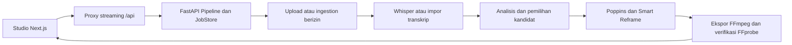

# Arsitektur PODCUT MultiPC

## Alur studio

| Komponen | Lokasi dan tanggung jawab |
|---|---|
| Studio | `frontend/app/page.tsx` mengelola proyek, preview, rekomendasi, dan export. `frontend/components/` memuat editor reframe, caption Poppins, dan panel setup Whisper. |
| Proxy | `frontend/app/api/[...path]/route.ts` meneruskan streaming upload/download dan range video. Ia memeriksa origin, identitas root/profile, dan token per sesi sebelum meneruskan request. |
| API dan proyek | `backend/app/main.py` mengatur pipeline FastAPI. `backend/app/store.py` menyimpan proyek dan status pekerjaan pada disk profil. |
| Input dan transkripsi | `ingestion.py` dan `ingestion_worker.py` mengurus retrieval yang diizinkan, cache, validasi, dan fallback. `media.py` menjalankan Whisper dan FFprobe. `model_provisioning.py` memeriksa model berdasarkan manifest. |
| Pemilihan klip | `analysis.py` memeriksa bukti transkrip, durasi, kualitas batas kalimat, dan duplikasi. Mode source memakai heuristik. `gemini_provider.py` merupakan integrasi provider yang terpisah, belum menjadi bagian uji live Stage 2. |
| Komposisi dan file akhir | `captions.py` membentuk dokumen Poppins dan SRT/VTT/ASS. `reframe_detection.py` dan `reframe_store.py` menyiapkan dan menyimpan plan crop. `media.py` menghasilkan MP4 lalu memeriksa hasil melalui FFprobe. ASD merupakan komponen eksperimen dengan dependensi/model tersendiri. |
| Mode desktop | `desktop/app/main.cjs` memvalidasi identitas, menjalankan frontend dan backend terkemas, dan mengawasi penghentian proses miliknya. `desktop/backend/PODCUTBackend.spec` menyiapkan backend PyInstaller. |

Path backend dalam tabel relatif terhadap `backend/app/` ketika hanya nama file yang ditampilkan. Rincian request, status, dan format ada di [kontrak API](API_CONTRACT.md) dan [ekstensi clipping](CLIPPING_UPGRADE_API.md).

## Isolasi workspace

- Root diambil dari lokasi source atau launcher dan disahkan melalui `podcut-dev-workspace.json`. Setiap clone memiliki `.dev/profile/` dan catatan kepemilikan root sendiri. Gunakan setup dan launcher untuk menyiapkannya.
- `.dev/profile/` menyimpan `config/backend.env`, cache, model, log, temporary files, data proyek, dan catatan proses. Toolchain lokal memakai `.tools/` dan `.venv/`. Build frontend dan dependensi Node berada di subfolder clone. Clone baru membangun profil dan dependensinya sendiri.
- Source dan paket desktop sama-sama memakai alamat loopback. Frontend memakai 3300 dan backend memakai 8300. Jalankan instans tersebut bergantian pada satu komputer. Komputer berbeda dapat memakai pasangan port yang sama.
- Launcher memeriksa executable, proses, port, root, dan token per sesi. Stop dibatasi ke proses milik catatan clone itu. Reuse profil diperbolehkan di clone yang sama dengan identitas pemilik yang cocok.
- Runtime paket desktop memisahkan direktori program dari profil lokal Windows. Paket atau QA Stage 2 perlu profil uji yang baru. Gunakan profil `.dev/profile/` untuk mode source. Simpan data dan profil paket lama pada tempatnya.

## Jalur build dan distribusi

`scripts/setup.ps1` menyiapkan toolchain dan dependensi. `scripts/build-quality-upgrade.ps1` mengoordinasikan Next.js standalone, PyInstaller, dan perakitan Electron melalui `desktop/build-desktop.mjs`. Build Quality baru memakai direktori run yang unik dan manifest SHA-256 sendiri.

Paket desktop yang dihasilkan ditujukan untuk pengembangan privat. Publikasi, installer, updater, penandatanganan, dan redistribusi codec memerlukan pemeriksaan serta persetujuan terpisah. Simpan bukti build di direktori lokal run dan catat hasil yang boleh dibagikan di handoff.
